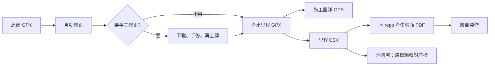

# 路標建置流程

從一條實際走過的航跡，到做好的反光路標、施工用的 GPS 航點、給消防署的定位資料，整條流程怎麼走。

本 repo 只負責其中「產生牌面 PDF」一步，其他步驟用到的工具列在各節。產生器本身的用法見 [README.md](README.md)。

## 1. 原始 GPX

起點是一條實際走過、沿著步道的航跡。不要用地圖上畫出來的線，也不要從試算表反推：路標的位置要落在實際的步道上。

把 GPX 上傳到[航跡管理器](https://gpx.oslab.tw)。

## 2. 自動修正

航跡管理器可以預覽自動修正的結果，確認後套用。修正後的航跡仍掛在同一條航跡底下，原始檔保留。

## 3. 視需要手工修正

自動修正處理不了的地方，例如繞路、折返、訊號飄移，就下載下來用編輯工具手修，再上傳。不需要的話跳過這一步。

## 4. 產出里程 GPX

用 [gpxtoolkit](https://gpxtoolkit.outdoorsafetylab.org/) 依指定間距在航跡上打出里程航點，例如每 100 m 一點，再下載 GPX 與 CSV。

航跡管理器之後也會提供這一步，把每次產生的里程結果存在來源航跡底下，記錄用的是哪一版航跡、哪些參數，方便日後追查某一批牌子是從哪一份資料做出來的。

## 多條路線的步道

一條步道底下有好幾條路線時，例如[玉山後四峰](玉山後四峰)的東小南山線、東小南鹿山支線、南玉山線、鹿山線，第 4 步要多做三件事：

1. **各路線分開產生里程點、分開校對。** 現地已經有的里程，例如舊路標或官方標示，不一定準，但新路標要和現地對得上，所以要人工移動點位，讓牌上的里程符合現地。校對後相鄰兩張牌的間距不會剛好是 100 m：南玉山線前 55 張的直線間距從 74 m 到 124 m 都有。
2. **共用路段只放一組點。** 幾條路線走同一段路時，同一個位置只標一個點，航點名稱帶上共用的路線。玉山後四峰的「南鹿東0.0K」到「南鹿東0.8K」是南玉山線、鹿山線、東小南山線共用的一段，到三叉路口才分開。
3. **合併成一份給施作團隊。** 各路線校對完，合併成一份 GPX 交給施作團隊。牌面 CSV 仍是每條路線一份，用 `GPX航點` 欄記下每張牌對應合併檔裡的哪個航點，現場與牌面才查得回來。

每條路線的路線代碼、底色與 CSV 慣例見 README 的「使用方式」。

## 5. 三個下游

### 施工團隊

里程 GPX 載進 GPS，現場照航點找位置施工。

### 牌面 PDF

1. 以 gpxtoolkit 匯出的 CSV 為底，補上牌面需要、但航跡裡沒有的欄位：路線名稱與編號、總里程、地標名稱、分段文字、左下角與右下角備註。欄名要和 SVG 樣版裡的佔位字一致，產生器會照欄名取代，見 README 的「CSV 資料檔」。
2. 依 README 產生 RGB 與 CMYK 兩份 PDF，人工逐張確認後送廠商製作。

範例：[阿玉山/mt_ayu.csv](阿玉山/mt_ayu.csv) 保留了航點名稱與座標欄，包括 `Waypoint`、緯度、經度、東距、北距；[白姑大山/SM400.csv](白姑大山/SM400.csv) 只留牌面用得到的欄位。

### 消防署

把同一份里程結果的路標編號與座標提供給消防署，要用保留座標欄的那份 CSV。山域報案時只要報出牌上的路標編號，就能對到經緯度。

## 版本對應

做出來的牌子、施工 GPS 裡的航點、給消防署的座標，要來自同一份里程結果。航跡重新修正、或里程重新產生之後，三邊都要換成新的那一份，不要只換其中一邊。
